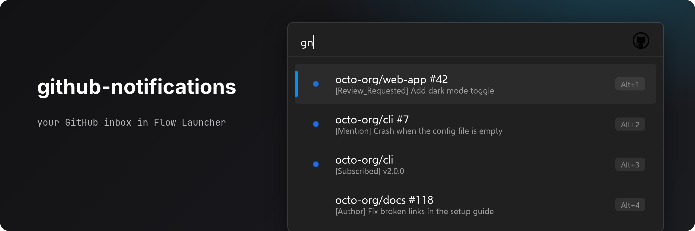

<!-- generated by readwright from docs/README.md.j2; edit the template, not this file -->


# Github Notifications

View and clear your GitHub notifications from Flow Launcher.

[](https://github.com/Garulf/Github-Notifications/actions/workflows/tests.yml) [](https://github.com/Garulf/Github-Notifications/releases/latest) [](https://github.com/Garulf/Github-Notifications/releases/latest)

[](https://www.buymeacoffee.com/garulf) [](https://github.com/sponsors/Garulf)

## Features

* **Your inbox at a keystroke.** Type `gn` to list your latest notifications, with unread ones marked by their own icon.
* **Open in the browser.** `Enter` opens the pull request, issue or release and marks it as read.
* **Filter as you type.** `gn web` only shows notifications whose title contains "web".
* **Clear the noise.** Mark one or all notifications as read from the context menu.
* **Your own format.** Choose what the title and subtitle of each result show.

## Usage

Type `gn` to see your notifications:

```
gn
```


Add some text to filter the results by title:


### Context menu

Open the context menu (`Shift+Enter` or right-click) on a notification to mark it as read, mark
everything as read, or fetch your notifications again:


## Installation

### Flow Launcher

In Flow Launcher, type:

```
pm install Github Notifications
```


### Manual installation

Download `Github-Notifications-<version>.zip` from the [latest release](https://github.com/Garulf/Github-Notifications/releases/latest) and unzip it into
`%appdata%\FlowLauncher\Plugins`, then restart Flow Launcher.

Pre-releases of the next version are published from the open release PR on the
[releases page](https://github.com/Garulf/Github-Notifications/releases) for testing. Flow Launcher won't offer them as updates.

## Configuration

The plugin needs a GitHub personal access token. Create a classic token at
[github.com/settings/tokens](https://github.com/settings/tokens) with the `notifications` scope, then open
**Settings → Plugins → Github Notifications** in Flow Launcher and paste it in:

| Setting | Default | Description |
| --- | --- | --- |
| Personal access token | | A classic token with the `notifications` scope |
| Max Results | `30` | The most notifications to fetch |
| Title format | `{repo_owner}/{repo_name} {num_symbol}{number}` | The title of each result |
| Subtitle format | `[{reason_title}] {subject_title}` | The subtitle of each result |

The formats can use these fields:

| Field | Example |
| --- | --- |
| `{repo_owner}` | `octo-org` |
| `{repo_name}` | `web-app` |
| `{repo_full_name}` | `octo-org/web-app` |
| `{num_symbol}` | `#` for pull requests and issues, empty otherwise |
| `{number}` | `42` for pull requests and issues, empty otherwise |
| `{reason_title}` | `Mention`, `Review_Requested`, `Subscribed`, ... |
| `{subject_title}` | `Add dark mode toggle` |
| `{subject_url}` | The API URL of the pull request, issue or release |
| `{release_title}` | `v2.0.0 in ` for anything that isn't a pull request or issue, empty otherwise |

## Requirements

* Flow Launcher 1.17.0 or newer
* Python 3.8 or newer, which Flow Launcher can install for you

## Changelog

See [CHANGELOG.md](CHANGELOG.md) for the full history.
